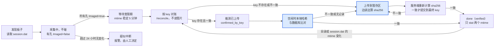

# 成像机端上传程序 IO 优化设计

2026-10-28（2026-10-30 补充图片正确性设计）

## 背景与目标

本方案把成像机上传程序的读盘量降到每个图片文件只读 1 次，冷启动从 6–7 小时降到分钟级，并保证拍摄期间不读图片；同时保证 MinIO 中保存、计算节点使用的图片与成像机上的原始文件逐字节一致。

**问题**：成像机上的 Go 上传程序（通过 nssm 注册为服务运行）占用硬盘读写过多。程序扫描元数据和图片，计算 sha256 后发给中心机 API，由 API 在后台判断是否需要上传。从日志看，一次全量哈希需要 6–7 小时，但不确定这期间是否受到了成像软件争抢 IO 的影响。

**最高优先级**（两条同等重要）：

1. **不能与成像软件争抢磁盘 IO**。上传慢一点可以接受，拍摄被拖慢不可以接受。
2. **MinIO 和计算节点上的图片必须绝对正确**。定义见下文。

**“图片正确”的定义**：MinIO 中 key 为 K 的对象，与成像机上**拍摄完成时**对应的文件逐字节一致；在验证通过之前，计算节点不能使用它。具体包括两层要求：

- **内容一致**：用 sha256 做端到端验证，不靠 size 或 mtime 推断。
- **未验证的对象对计算节点不可见**：传了一半、传错了、还没校验的对象，都不能被拿去计算。

拍摄完成后本地文件又被修改，如何处理属于单独的策略问题，见“详细设计”第 10 节。

**目标**

- 拍摄进行中的板子，程序不读取其中任何图片。
- 每个新图片文件在成像机上只读 1 次（即上传时那一次）；额外的校验读取放在中心机上，或者放在成像机的空闲时间里。
- 重启或冷启动时不需要等待全量哈希就能开始工作。
- 需要读文件时，只在成像机空闲时读，并且能随时中断。
- 每个提供给计算节点的对象都经过服务端 sha256 校验；已经正确的对象永远不会被覆盖。

**范围**：成像机上的 Go 程序，以及中心机 API、MinIO 和数据库中的配套改动。计算节点只涉及下载后的 sha256 校验，网页只涉及“未验证”状态的展示。

## 现状与根因分析

当前流程每个新文件至少要读 2 次，而且重启以后所有文件都要重新读一遍。以下根因是根据架构推断出来的，需要用本节末尾的方法在成像机上实测确认。

**当前流程**

1. 遍历扫描目录，对图片计算 sha256（第 1 次读）。
2. 把 sha256 发给中心机 API，API 在后台检查图片是否已存在。
3. 需要上传时，再读一次文件并上传（第 2 次读）。

**疑似根因**

| 根因 | 现象 | 影响 |
| --- | --- | --- |
| 没有持久化的哈希缓存 | 重启或每轮扫描都重新哈希全部文件 | 冷启动 6–7 小时 |
| 哈希和上传分开读 | 每个新文件读 2 次；大文件在两次读之间已被挤出系统缓存 | 新文件的 IO 翻倍 |
| 服务端异步检查 | 客户端在等待结果期间，可能在下一轮重新哈希同一个文件 | 待实测确认 |
| 不判断是否拍摄完成 | 拍摄期间就去读同一块盘上的文件 | 直接和成像软件争抢磁盘 |
| 单纯依赖系统调度 | 没有降低 IO 优先级，也没有限速或让路机制 | 争抢时不会主动退让 |

**当前流程本身的正确性隐患**：哈希和上传分两次读取文件。如果文件在两次读取之间发生变化，数据库中记录的 sha256 就和 MinIO 中的对象不一致。新方案在同一次读取中完成哈希和上传，在这一点上更可靠。

**实测确认方法**

- **Process Monitor**（Sysinternals）：只看上传程序的 ReadFile 操作，跑两个扫描周期，然后打开 Tools → File Summary。如果同一个文件在每个周期都被完整读一遍，就证实了第一条根因。
- **资源监视器**（resmon）：在“磁盘”页看哪个进程在读、读的是哪个文件，同时观察磁盘队列长度。
- **typeperf**：长时间记录上传程序的 `IO Read Bytes/sec` 和磁盘的 `% Disk Time`；再用 `nssm stop` 停掉服务对比，量化影响。
- **核实 6–7 小时**：理论耗时 = 图片总大小 ÷ 磁盘顺序读速度。按日志算出每个文件的吞吐量，和拍摄时间段对照；如果拍摄时吞吐量明显下降，就说明发生了争抢。另外看 CPU 是否长时间占满一个核：较老的 Intel CPU 没有 SHA-NI 指令，哈希可能受 CPU 限制。

## 关键事实与假设

整个设计的前提是：object key 可以只用本地的元数据和目录信息精确还原出来，不需要读取图片内容。

| 项目 | 内容 | 状态 |
| --- | --- | --- |
| object key 格式 | `来源主机/项目/年/月/日/板子目录/文件名`，示例 `pc1/20260101-1234A-ABCD/2026/01/05/PlateBarcode_12_34_56/A1.tif` | 已确认 |
| key 与本地路径的对应关系 | 从代码看，可以一一对应 | 基本确认 |
| key 中的日期 | 来自 session.dat 里的拍摄时间，整块板子共用一个 | 已确认 |
| 元数据文件 | CellMetric 成像机生成的 session.dat | 已确认 |
| Imaged 字段 | 布尔值，表示是否拍摄完成。**暂按每个孔一个处理** | 假设，待拿到文件后确认 |
| 中心机数据库 | 记录了来源机器、项目、well；没有记录本地原始路径、size、mtime | 已确认 |
| sha256 的用途 | 目前仅用于识别图片身份（判断是否已上传） | 已确认 |

### Windows 上的 mtime

**有，而且可以作为缓存失效的判断依据。** NTFS 给每个文件和目录保存了创建时间（CreationTime）、最后写入时间（LastWriteTime）和最后访问时间（LastAccessTime），另外还有一个记录元数据变化的 ChangeTime。所谓 mtime，就是 LastWriteTime：Go 的 `FileInfo.ModTime()` 在 Windows 上返回的就是它。

使用时要注意：

- **精度和时区**：NTFS 的精度是 100 纳秒，存的是 UTC，不受时区和夏令时影响。FAT32 的精度只有 2 秒，并且存的是本地时间。可以用 `fsutil fsinfo volumeinfo D:` 确认数据盘是不是 NTFS。
- **复制文件**：用资源管理器或 robocopy 复制时，LastWriteTime 会保留原值，CreationTime 会变成复制的时间。所以用 mtime 判断“内容是否改过”是合适的。
- **目录的 mtime**：目录里新增、删除、重命名文件时会更新；但目录里的文件内容被修改时**不会**更新，子目录里的变化也不会影响上层目录。
- **正在写入的文件**：遍历目录时（`WalkDir` 和 `FindFirstFile`）拿到的大小和时间，对仍在写入的文件可能是滞后的。需要准确值时对单个文件调用 `os.Stat`。本设计只处理 Imaged=true 并且已经过了宽限期的孔，所以基本不受影响。
- **最后访问时间不可靠**：很多 Windows 系统上它的更新被关闭或者延迟了（可以用 `fsutil behavior query disablelastaccess` 查看），不要使用。
- **程序可以改写 mtime**：软件可以通过 SetFileTime 把 mtime 设成任意值，这种情况很少见。为此缓存里同时记录 size，可以再加上 NTFS 文件 ID，并保留每周一次的对账扫描作为兜底。
- **不要跨机器比较时间**：成像机和中心机的时钟可能不一致。判断“文件上传后是否被改过”时，只比较成像机自己产生的两个 mtime，见“详细设计”第 3 节。

## 总体设计

以板子为单位管理状态：拍摄中的板子完全不碰；拍完以后先用 object key 对账；只有对不上的文件才上传，对得上的历史文件在空闲时补做哈希校验。任何文件只有经过 sha256 校验才算完成。



只有高亮的两步会读取成像机上的图片，而且都受空闲闸门控制；其余步骤只读 session.dat 和文件元数据。服务端的重新计算使用中心机的 IO，不影响成像机。

- **冷启动**（本地缓存为空或已损坏）：所有板子都从“发现板子”开始走一遍。对账不读图片，让程序马上知道哪些文件从未上传过并优先处理；对得上的历史文件进入后台校验队列，在空闲时间慢慢补做哈希，直到全部变成 verified。
- **重启**：从本地缓存恢复每块板子和每个文件的状态。done 的板子只检查 session.dat 和板子目录的 mtime。
- **日常运行**：新出现的板子按图中的流程处理；每周做一次对账扫描（只做 stat），作为兜底。

## 详细设计

核心思路是：用 object key 判断“是否已经上传”，用 sha256 做端到端的完整性校验。前者不需要读文件；后者在上传时顺便算出来，再由服务端独立计算一次进行比对。

### 1. 本地状态缓存

用 bbolt 或 SQLite 存储，写入是事务性的，进程被强制结束或断电不会导致缓存损坏。缓存丢失或损坏时，走冷启动对账流程恢复，**不要回退到全量哈希**。

| 层级 | 主键 | 字段 |
| --- | --- | --- |
| 板子 | 板子目录路径 | session.dat 的 mtime，目录的 mtime，项目，拍摄日期，状态（采集中 / 处理中 / done / 疑似中断） |
| 文件 | object key | 本地路径，size，mtime，NTFS 文件 ID（可选），sha256，状态，暂存区 key（上传中时） |

文件状态：

| 状态 | 含义 | 下一步 |
| --- | --- | --- |
| `unknown` | 还没有处理 | 对账 |
| `uploading` | 正在上传到暂存区，或者等待服务端校验 | 校验通过 → `verified`；失败或中断 → 重新上传 |
| `confirmed_by_key` | 冷启动对账时推测已上传，**尚未验证内容** | 进入后台校验队列 |
| `verified` | 本地 sha256 与服务端记录一致，并且服务端已确认 MinIO 对象内容正确 | 完成 |
| `conflict` | 最终 key 已存在，但内容与本地不同 | 报警，人工处理 |

只有 `verified` 才算完成。状态只在校验成功后才前进，所以程序在任何时刻被强制结束，重启后最多重做没完成的那一步，结果依然正确。

### 2. object key 生成

- 上传和对账只使用**同一个**函数 `BuildObjectKey(host, session, plateDir, fileName)`，不允许另写一套逻辑。
- 从生产数据库取几十组真实的 `(session.dat, 文件名) → key` 作为固定样本，写成单元测试。样本要覆盖：凌晨拍摄的板子、最早和最新的项目、目录名带中文或空格的板子。
- 拍摄时间的解析和格式化不做任何时区转换。如果 session.dat 存的是不带时区的本地时间，就保持原样。
- 规范化规则要明确写下来：大小写、well 的写法（A1 还是 A01）、路径分隔符、扩展名、Unicode 形式。

### 3. 对账接口（中心机）

```
POST /reconcile
{ "host": "pc1", "plate_prefix": "pc1/<项目>/2026/01/05/<板子目录>/",
  "items": [ {"key": "...", "size": 123, "mtime": "..."} ] }
→ 每个 key 返回：exists, status, size, sha256, client_mtime
```

- 以板子为单位请求，每批 1000–5000 条；服务端查 MySQL，不走 MinIO 的 List 接口。
- 成像机不直接访问 MinIO 的管理凭证，存储凭证只留在中心机。
- **判定规则**：

| 服务端记录 | 判定 |
| --- | --- |
| key 不存在，或者没有 verified 记录 | 放进上传队列 |
| verified，size 一致，并且本地当前 mtime 等于服务端保存的 `client_mtime` | `verified`（这个 mtime 是上传时由成像机上报的，两边都来自成像机自己的时钟） |
| verified，但 size 或 mtime 不一致 | 文件在上传后被改动过，按第 10 节的策略处理 |
| 历史记录，没有保存 `client_mtime`，但 size 一致 | `confirmed_by_key`，进入后台校验队列（第 7 节） |

- **不要**用本地 mtime 和服务端的 `uploaded_at` 比较：这是在比较两台机器的时钟。如果成像机时钟偏慢，上传后被修改过的文件也会被判为“没改过”。
- 顺便记录“数据库有记录但 MinIO 里没有对象”等不一致的情况，只写日志，不自动修复。

### 4. Imaged 门控（按每孔一个 Imaged 设计）

- 只有当板子里**所有孔**都是 Imaged=true，并且 session.dat 和板子目录的 mtime 都稳定超过宽限期（初始值 5 分钟，可配置），才开始处理这块板子。
- 不采用“拍完一个孔传一个孔”的方式：这样虽然上传更早，但会在拍摄期间读盘，违反最高优先级。
- 核对文件是否齐全：session.dat 里列出的孔，在目录里都要有对应的 .tif。
- 读取 session.dat 后立刻关闭文件。只有它的 mtime 变化时才重新解析。
- 如果之后确认 Imaged 是整块板子一个，只需要把“所有孔都为 true”换成“这一个字段为 true”，其余不变。

### 5. IO 控制

- **后台模式**：进程启动时调用 `windows.SetPriorityClass(windows.CurrentProcess(), windows.PROCESS_MODE_BACKGROUND_BEGIN)`，把 IO 和内存优先级都降到最低。
- **空闲闸门**：以下条件全部满足才允许读图片：没有板子处于采集中；成像软件进程的 `IO Write Bytes/sec` 为 0；磁盘 `% Idle Time` 高于 90%。条件要连续保持一段时间才算满足，避免频繁切换；任何一项不满足就立刻暂停。
- **分块读取、可以中断**：哈希按块读取（1–4 MB），每读一块都检查一次闸门和 ctx；再叠加一个硬性限速（用 `golang.org/x/time/rate`，初始值 30 MB/s）。哈希串行执行，上传并发数不超过 2。上传使用分片，暂停只发生在分片之间（第 6 节）。
- **文件共享模式**：用 `windows.CreateFile` 打开文件，共享模式加上 `FILE_SHARE_DELETE`。Go 的 `os.Open` 不带这个标志，程序持有句柄期间，成像软件就无法重命名或删除这个文件。暂停时间超过 1 分钟就关闭句柄，之后从头重新读。
- **读取前后检查文件是否变化**：打开文件后和读完后各调用一次 `f.Stat()`。size、mtime、实际读取的字节数三者只要有一个对不上，就丢弃这次结果，稍后重试。哈希和上传共用同一个 `gatedReader`，都执行这项检查。

### 6. 上传：先传到暂存区，服务端校验通过后再提交

```
成像机                                     中心机
  │ ① 申请上传，得到暂存区 key：staging/<uuid>
  │ ② 读一遍文件：分片上传到 staging/<uuid>，同时计算 sha256（只读一次）
  │    读之前和读之后各 Stat 一次，发现变化 → 中止分片上传，稍后重试
  │ ③ commit(key, staging_key, sha256, size, 本地 mtime)
  │                                        ④ 从 MinIO 读出暂存对象，在中心机上重新计算 sha256
  │                                        ⑤ 与客户端报告的 sha256 比对：
  │                                           一致   → MinIO 内部复制到最终 key，写 MySQL（状态 verified，
  │                                                    保存 sha256、size、client_mtime），再放进计算队列
  │                                           不一致 → 删除暂存对象，通知客户端重新上传
  │                                        ⑥ 最终 key 已经存在时：
  │                                           sha256 相同 → 视为成功（重复上传）
  │                                           sha256 不同 → 拒绝覆盖，状态 conflict，报警，人工处理
  │ ⑦ 收到 verified 后，本地状态改为 verified
```

```go
h := sha256.New()
body := io.TeeReader(gatedReader(ctx, f), h) // 经过闸门、限速和读取前后的 Stat 检查
stagingKey, err := uploadMultipart(ctx, body, size) // 分片之间检查闸门，可暂停
if err != nil { return err } // 失败时中止分片上传，不留下可见对象
res, err := commit(ctx, key, stagingKey, hex.EncodeToString(h.Sum(nil)), size, mtime)
```

这样可以保证：

- **计算节点只能看到通过校验的对象**：只有第 ⑤ 步才会把对象放进最终 key 并加入计算队列。
- **已经正确的对象永远不会被覆盖**：第 ⑥ 步拒绝用不同内容覆盖已有对象。
- **中途失败不会留下“看起来已完成”的记录**：暂存区里残留的对象定期清理；只有 MySQL 中状态为 verified 的记录才算完成。
- **被强制结束也不会产生错误数据**：分片上传在完成之前对象不可见，S3 协议保证对象要么完整存在、要么不存在；中途放弃时调用 abort 即可。

补充说明：

- **为什么在服务端重新计算，而不是让 MinIO 在上传时校验**：S3 协议的单次 PUT 需要在上传前提供校验值，等于要先读一遍文件，违背“只读一次”。分片上传加逐片校验可以绕开这个问题，但实现更复杂。服务端重新计算一次最简单、最可靠，中心机多读一次文件的代价可以接受。
- **分片上传**（例如每片 16 MB）：每上传完一片检查一次闸门，需要暂停时停在两片之间，不会让一个 HTTP 请求长时间挂起导致超时。
- **sha256 的去重语义**：sha256 目前只用于识别图片身份，改为按 key 判断是否已上传不会影响其他功能。

### 7. 历史数据的后台校验

冷启动对账得到的 `confirmed_by_key` 只证明“存在一个同名、同大小的对象”，**不能证明内容相同**（未压缩 TIFF 的大小往往完全一样）。因此：

- 所有 `confirmed_by_key` 的文件都放进后台校验队列，只在空闲闸门打开时读取并计算 sha256，再与 MySQL 中记录的 sha256 比对：
  - 一致 → `verified`，并补写 `client_mtime`。
  - 不一致 → 按新文件走第 6 节的上传流程。因为第 ⑥ 步拒绝覆盖，会进入 `conflict`，需要人工确认哪一份是对的。
  - 数据库中没有 sha256 → 按新文件走第 6 节的流程。
- 这相当于把原来的 6–7 小时全量哈希**分散到空闲时间里完成**，可能需要几天到几周，但不影响拍摄，也不阻塞新文件的处理。
- 全部校验完成之前，网页上给这些历史图片标记“未验证”。

### 8. 多层兜底校验

| 层级 | 做什么 | 由谁执行 | 占用谁的 IO |
| --- | --- | --- | --- |
| 上传时 | 服务端重新计算 sha256，通过后才提交（第 6 节） | 中心机 | 中心机 |
| 计算时 | 计算节点下载图片时同时计算 sha256，不一致就拒绝计算并报警 | 计算节点 | 计算节点 |
| 定期审计 | 在中心机上分批重新计算 MinIO 中对象的 sha256，与 MySQL 比对；同时核对数据库记录的对象在 MinIO 中都存在 | 中心机 | 中心机 |
| 格式检查（可选） | 校验时顺便解析 TIFF 头，确认尺寸、位深等参数符合预期 | 中心机 | 中心机 |

### 9. 服务端配套改动

- 图片表新增字段：object key（如果还没有的话，并建索引）、相对路径、size、`client_mtime`（成像机上报的本地 mtime）、uploaded_at、状态（verified / conflict 等）。
- 新增接口：`/reconcile`（对账）、申请暂存区上传、`commit`（校验并提交）。
- 校验服务：读取暂存对象、计算 sha256、复制到最终 key、拒绝覆盖不同内容。
- 暂存区清理：定期删除超过一定时间（例如 24 小时）仍未提交的暂存对象，以及未完成的分片上传。
- MinIO 开启版本控制，作为防止误覆盖的额外保险。
- 定期审计任务（第 8 节）。
- 保留现有的“按 sha256 检查”接口一段时间，等所有成像机都升级以后再下线。

### 10. 上传后本地文件被修改的处理策略（待决定）

| 方案 | 做法 | 评价 |
| --- | --- | --- |
| **A. 以首次上传的版本为准**（建议） | MinIO 保持原样，本地的修改只记录日志并报警 | 最安全，识别结果始终对应原始图片 |
| B. 以最新的本地版本为准 | 重新上传；必须开启 MinIO 版本控制或使用新的 key，同时让旧的识别结果失效并重新计算 | 需要额外处理结果失效和版本管理 |

如果担心“内容被修改但 mtime 没变”这种少见情况，可以把每周的对账扫描改为在空闲时间对 done 板子轮流抽样计算哈希。

## 风险与边界情况

最严重的风险是把一个没有正确上传的文件误判为“已上传”，或者让计算节点使用了内容不正确的对象，这会导致数据静默出错。反过来，把已上传的文件判为“未知”，只是多读一次文件。所有规则都偏向后者。

| 风险 | 后果 | 应对 |
| --- | --- | --- |
| key 生成规则和当年上传时不一致（时区、规范化、格式历史变更） | 大批文件匹配不上，退化为全量上传 | 固定样本单元测试；上线前用只读演练检查匹配率 |
| 冷启动对账把内容不同的文件判为已上传 | 错误数据被当作正确 | `confirmed_by_key` 只是临时状态，必须经过后台哈希校验才能变成 verified |
| 比较成像机 mtime 和服务端 uploaded_at 时，两台机器时钟不一致 | 上传后被修改的文件被误判为未修改 | 只比较成像机自己产生的 mtime（`client_mtime`） |
| 上传过程中传输出错或数据被截断 | MinIO 中保存了错误内容 | 服务端重新计算 sha256，一致才提交 |
| 不同的文件生成了同一个 key，或者重传覆盖了正确的对象 | 正确数据被覆盖 | 服务端拒绝用不同内容覆盖已有对象（conflict）；开启 MinIO 版本控制；按板子检查“本地文件数 = 去重后的 key 数” |
| 上传成功但 commit 失败（网络断开、程序被强制结束） | 对象存在但没有校验记录 | 先传暂存区，只有 verified 记录才算完成；暂存对象定期清理 |
| 计算节点在校验完成前拿到对象 | 用错误或不完整的图片计算 | 只有提交到最终 key 后才放进计算队列；计算节点下载时再校验一次 |
| 读取过程中文件被写入 | 上传了不完整或变化中的内容 | 读取前后各 Stat 一次，不一致就丢弃重试；Imaged 门控和宽限期 |
| Imaged=true 时文件还没有完全写完 | 上传了不完整的图片 | 宽限期；核对孔是否齐全；读取前后 Stat 检查 |
| 拍摄中断，Imaged 永远不会变成 true | 板子永远不会被处理，也没人知道 | 超过 24 小时没有变化就标记为“疑似中断”并报警；是否上传由实验人员决定 |
| done 板子里的文件内容被原地修改 | 目录 mtime 不会变，日常运行时发现不了 | 每周一次对账扫描（只做 stat，受空闲闸门控制）；必要时轮流抽样哈希 |
| 程序持有文件句柄时，成像软件要重命名或删除文件 | 成像软件保存失败 | 共享模式加上 FILE_SHARE_DELETE；尽早关闭句柄；查一下成像软件日志里有没有“文件被占用”的报错 |
| 仅靠后台 IO 优先级仍然抢占磁盘 | SSD/NVMe 上的硬件队列会绕过系统优先级 | 空闲闸门 + 限速，忙的时候主动停下 |
| 本地缓存损坏 | 需要重建 | 事务性存储；损坏时走冷启动对账，不重新哈希 |
| MinIO 中已保存的对象后来损坏或被误删 | 已验证的数据变得不正确 | 定期审计；版本控制 |

## 实施计划与验证指标

按照改动小、风险低、见效快的顺序分三个阶段实施，每个阶段先在一台成像机上验证，再推广到全部机器。

**阶段一：立刻降低争抢**

1. 先用 Process Monitor 和 typeperf 记录修改前的基线数据。
2. 启动时进入后台 IO 优先级；打开文件时加上 FILE_SHARE_DELETE；哈希改为串行，缓冲区加大到 1–4 MB。
3. 本地状态缓存持久化，重启后不再重新哈希。

**阶段二：冷启动不读图片，上传可校验**

1. 抽出 `BuildObjectKey()` 并补上固定样本单元测试。
2. 中心机：图片表加字段；实现 `/reconcile`、暂存区上传、`commit` 校验与提交；开启 MinIO 版本控制。
3. 客户端：上传改为“暂存区 + commit”，读取前后 Stat 检查。
4. 在一台成像机上做只读演练：只输出对比报告，不写缓存。匹配率接近 100% 以后，再正式启用。
5. Imaged 门控和宽限期；done 的板子只做 stat。

**阶段三：新文件只读一次，并完善兜底**

1. 上传时用 TeeReader 同时计算哈希；分片上传，分片之间检查闸门。
2. 空闲闸门、分块可中断读取、限速。
3. 历史数据后台校验（`confirmed_by_key` → verified）。
4. 计算节点下载时校验 sha256；中心机定期审计；暂存区清理。
5. 疑似中断的板子报警；每周一次对账扫描。

**验证指标**

| 指标 | 测量方法 | 目标 |
| --- | --- | --- |
| 拍摄期间上传程序的读盘量 | typeperf `\Process(程序名)\IO Read Bytes/sec` | 接近 0 |
| 每个新文件在成像机上被读取的次数 | Process Monitor 的 File Summary | 累计读取字节数约等于文件大小的 1 倍 |
| 冷启动耗时 | 程序日志 | 从 6–7 小时降到分钟级（不含后台校验） |
| 冷启动匹配率 | 只读演练报告 | 接近 100%，匹配不上的都能解释原因 |
| 历史数据校验进度 | MySQL 中 verified 记录的比例 | 持续上升，最终 100% |
| 服务端校验失败、计算节点校验失败、审计不一致 | 报警记录 | 0；出现时每一次都能查明原因 |
| conflict 数量 | MySQL | 0；出现时人工处理 |
| 成像软件是否受影响 | 拍摄期间的磁盘队列长度；成像软件的报错日志 | 与停掉上传服务时没有明显差别 |

## 待确认问题

- [ ] Imaged 是每个孔一个，还是整块板子一个？（需要拿到一份 session.dat 样本）
- [ ] session.dat 里的拍摄时间是什么格式，带不带时区？现在的代码是怎么解析的？
- [ ] session.dat 里有没有预期的孔列表或者孔的数量，可以用来核对文件是否齐全？
- [ ] 成像软件是先写完图片再更新 Imaged，还是反过来？（决定宽限期设多长）
- [ ] object key 的格式历史上有没有变过？MinIO 是否开启了版本控制？
- [ ] 数据库里是否已经保存了 object key 和 sha256？
- [ ] 当前客户端是直接上传到 MinIO（presigned URL），还是经过 FastAPI 中转？
- [ ] 上传后本地文件被修改时，采用方案 A 还是方案 B？（第 10 节）
- [ ] 成像机的数据盘是机械盘还是 SSD，文件系统是否为 NTFS？
- [ ] 成像软件的日志里有没有出现过“文件被占用”或者保存失败的报错？
- [ ] 拍摄中断的板子（Imaged 一直为 false），业务上应该怎么处理？
