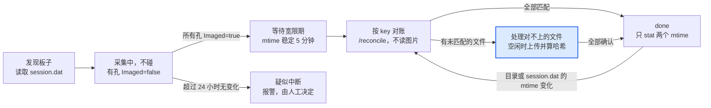

# 成像机端上传程序 IO 优化设计

2026-10-28

## 背景与目标

本方案把成像机上传程序的读盘量降到每个图片文件只读 1 次，冷启动从 6–7 小时降到分钟级，并保证拍摄期间不读图片。

**问题**：成像机上的 Go 上传程序（通过 nssm 注册为服务运行）占用硬盘读写过多。程序扫描元数据和图片，计算 sha256 后发给中心机 API，由 API 在后台判断是否需要上传。从日志看，一次全量哈希需要 6–7 小时，但不确定这期间是否受到了成像软件争抢 IO 的影响。

**最高优先级**：不能与成像软件争抢磁盘 IO。上传慢一点可以接受，拍摄被拖慢不可以接受。

**目标**

- 拍摄进行中的板子，程序不读取其中任何图片。
- 每个图片文件在整个生命周期内只从磁盘读 1 次（即上传时那一次）。
- 重启或冷启动时不需要全量哈希。
- 需要读文件时，只在成像机空闲时读，并且能随时中断。

**范围**：成像机上的 Go 程序，以及中心机 API 和数据库中的配套改动。计算节点和网页不在本文范围内。

## 现状与根因分析

当前流程每个新文件至少要读 2 次，而且重启以后所有文件都要重新读一遍。以下根因是根据架构推断出来的，需要用本节末尾的方法在成像机上实测确认。

**当前流程**

1. 遍历扫描目录，对图片计算 sha256（第 1 次读）。
2. 把 sha256 发给中心机 API，API 在后台检查图片是否已存在。
3. 需要上传时，再读一次文件并上传（第 2 次读）。

**疑似根因**

| 根因 | 现象 | 影响 |
| --- | --- | --- |
| 没有持久化的哈希缓存 | 重启或每轮扫描都重新哈希全部文件 | 冷启动 6–7 小时 |
| 哈希和上传分开读 | 每个新文件读 2 次；大文件在两次读之间已被挤出系统缓存 | 新文件的 IO 翻倍 |
| 服务端异步检查 | 客户端在等待结果期间，可能在下一轮重新哈希同一个文件 | 待实测确认 |
| 不判断是否拍摄完成 | 拍摄期间就去读同一块盘上的文件 | 直接和成像软件争抢磁盘 |
| 单纯依赖系统调度 | 没有降低 IO 优先级，也没有限速或让路机制 | 争抢时不会主动退让 |

**实测确认方法**

- **Process Monitor**（Sysinternals）：只看上传程序的 ReadFile 操作，跑两个扫描周期，然后打开 Tools → File Summary。如果同一个文件在每个周期都被完整读一遍，就证实了第一条根因。
- **资源监视器**（resmon）：在“磁盘”页看哪个进程在读、读的是哪个文件，同时观察磁盘队列长度。
- **typeperf**：长时间记录上传程序的 `IO Read Bytes/sec` 和磁盘的 `% Disk Time`；再用 `nssm stop` 停掉服务对比，量化影响。
- **核实 6–7 小时**：理论耗时 = 图片总大小 ÷ 磁盘顺序读速度。按日志算出每个文件的吞吐量，和拍摄时间段对照；如果拍摄时吞吐量明显下降，就说明发生了争抢。另外看 CPU 是否长时间占满一个核：较老的 Intel CPU 没有 SHA-NI 指令，哈希可能受 CPU 限制。

## 关键事实与假设

整个设计的前提是：object key 可以只用本地的元数据和目录信息精确还原出来，不需要读取图片内容。

| 项目 | 内容 | 状态 |
| --- | --- | --- |
| object key 格式 | `来源主机/项目/年/月/日/板子目录/文件名`，示例 `pc1/20260101-1234A-ABCD/2026/01/05/PlateBarcode_12_34_56/A1.tif` | 已确认 |
| key 与本地路径的对应关系 | 从代码看，可以一一对应 | 基本确认 |
| key 中的日期 | 来自 session.dat 里的拍摄时间，整块板子共用一个 | 已确认 |
| 元数据文件 | CellMetric 成像机生成的 session.dat | 已确认 |
| Imaged 字段 | 布尔值，表示是否拍摄完成。**暂按每个孔一个处理** | 假设，待拿到文件后确认 |
| 中心机数据库 | 记录了来源机器、项目、well；没有记录本地原始路径、size、mtime | 已确认 |

### Windows 上的 mtime

**有，而且可以作为缓存失效的判断依据。** NTFS 给每个文件和目录保存了创建时间（CreationTime）、最后写入时间（LastWriteTime）和最后访问时间（LastAccessTime），另外还有一个记录元数据变化的 ChangeTime。所谓 mtime，就是 LastWriteTime：Go 的 `FileInfo.ModTime()` 在 Windows 上返回的就是它。

使用时要注意：

- **精度和时区**：NTFS 的精度是 100 纳秒，存的是 UTC，不受时区和夏令时影响。FAT32 的精度只有 2 秒，并且存的是本地时间。可以用 `fsutil fsinfo volumeinfo D:` 确认数据盘是不是 NTFS。
- **复制文件**：用资源管理器或 robocopy 复制时，LastWriteTime 会保留原值，CreationTime 会变成复制的时间。所以用 mtime 判断“内容是否改过”是合适的。
- **目录的 mtime**：目录里新增、删除、重命名文件时会更新；但目录里的文件内容被修改时**不会**更新，子目录里的变化也不会影响上层目录。
- **正在写入的文件**：遍历目录时（`WalkDir` 和 `FindFirstFile`）拿到的大小和时间，对仍在写入的文件可能是滞后的。需要准确值时对单个文件调用 `os.Stat`。本设计只处理 Imaged=true 并且已经过了宽限期的孔，所以基本不受影响。
- **最后访问时间不可靠**：很多 Windows 系统上它的更新被关闭或者延迟了（可以用 `fsutil behavior query disablelastaccess` 查看），不要使用。
- **程序可以改写 mtime**：软件可以通过 SetFileTime 把 mtime 设成任意值，这种情况很少见。为此缓存里同时记录 size，可以再加上 NTFS 文件 ID，并保留每周一次的对账扫描作为兜底。

## 总体设计

以板子为单位管理状态：拍摄中的板子完全不碰；拍完以后先用 object key 对账；只有对不上的文件才读取图片内容。



从发现板子到 done，只有高亮的那一步会读取图片，而且受空闲闸门控制；其余步骤只读 session.dat 和文件元数据。

- **冷启动**（本地缓存为空或已损坏）：所有板子都从“发现板子”开始走一遍。对账时不读图片，通常只有很少的文件会进入“处理对不上的文件”。
- **重启**：从本地缓存恢复每块板子的状态。done 的板子只检查 session.dat 和板子目录的 mtime。
- **日常运行**：新出现的板子按图中的流程处理；每周做一次对账扫描（只做 stat），作为兜底。

## 详细设计

核心思路是：用 object key 判断“是否已经上传”，用 sha256 做完整性校验。前者不需要读文件，后者在上传时顺便算出来。

### 1. 本地状态缓存

用 bbolt 或 SQLite 存储，写入是事务性的，进程崩溃或断电不会导致缓存损坏。缓存丢失或损坏时，走冷启动对账流程恢复，**不要回退到全量哈希**。

| 层级 | 主键 | 字段 |
| --- | --- | --- |
| 板子 | 板子目录路径 | session.dat 的 mtime，目录的 mtime，项目，拍摄日期，状态（采集中 / 处理中 / done / 疑似中断） |
| 文件 | object key | 本地路径，size，mtime，NTFS 文件 ID（可选），sha256，状态 |

文件状态：`unknown → uploaded → confirmed_by_hash`；通过冷启动对账推断出来的记为 `confirmed_by_key`。两种 confirmed 分开记录，后台校验任务只需要处理后者。

### 2. object key 生成

- 上传和对账只使用**同一个**函数 `BuildObjectKey(host, session, plateDir, fileName)`，不允许另写一套逻辑。
- 从生产数据库取几十组真实的 `(session.dat, 文件名) → key` 作为固定样本，写成单元测试。样本要覆盖：凌晨拍摄的板子、最早和最新的项目、目录名带中文或空格的板子。
- 拍摄时间的解析和格式化不做任何时区转换。如果 session.dat 存的是不带时区的本地时间，就保持原样。
- 规范化规则要明确写下来：大小写、well 的写法（A1 还是 A01）、路径分隔符、扩展名、Unicode 形式。

### 3. 对账接口（中心机）

```
POST /reconcile
{ "host": "pc1", "plate_prefix": "pc1/<项目>/2026/01/05/<板子目录>/",
  "items": [ {"key": "...", "size": 123, "mtime": "..."} ] }
→ 每个 key 返回：exists, size, sha256, uploaded_at
```

- 以板子为单位请求，每批 1000–5000 条；服务端优先查 MySQL，不走 MinIO 的 List 接口。
- 成像机不直接访问 MinIO，存储凭证只留在中心机。
- 判定规则：key 存在，size 一致，并且本地 mtime 不晚于 uploaded_at → `confirmed_by_key`；key 存在但有一项不符 → 放进哈希队列；key 不存在 → 放进上传队列。
- 顺便记录“数据库有记录但 MinIO 里没有对象”等不一致的情况，只写日志，不自动修复。

### 4. Imaged 门控（按每孔一个 Imaged 设计）

- 只有当板子里**所有孔**都是 Imaged=true，并且 session.dat 和板子目录的 mtime 都稳定超过宽限期（初始值 5 分钟，可配置），才开始处理这块板子。
- 不采用“拍完一个孔传一个孔”的方式：这样虽然上传更早，但会在拍摄期间读盘，违反最高优先级。
- 核对文件是否齐全：session.dat 里列出的孔，在目录里都要有对应的 .tif。
- 读取 session.dat 后立刻关闭文件。只有它的 mtime 变化时才重新解析。
- 如果之后确认 Imaged 是整块板子一个，只需要把“所有孔都为 true”换成“这一个字段为 true”，其余不变。

### 5. IO 控制

- **后台模式**：进程启动时调用 `windows.SetPriorityClass(windows.CurrentProcess(), windows.PROCESS_MODE_BACKGROUND_BEGIN)`，把 IO 和内存优先级都降到最低。
- **空闲闸门**：以下条件全部满足才允许读图片：没有板子处于采集中；成像软件进程的 `IO Write Bytes/sec` 为 0；磁盘 `% Idle Time` 高于 90%。条件要连续保持一段时间才算满足，避免频繁切换；任何一项不满足就立刻暂停。
- **分块读取、可以中断**：每次读 4 MB，每读一块都检查一次闸门；再叠加一个硬性限速（用 `golang.org/x/time/rate`，初始值 30 MB/s）。哈希串行执行，上传并发数不超过 2。
- **文件共享模式**：用 `windows.CreateFile` 打开文件，共享模式加上 `FILE_SHARE_DELETE`。Go 的 `os.Open` 不带这个标志，程序持有句柄期间，成像软件就无法重命名或删除这个文件。暂停时间超过 1 分钟就关闭句柄，之后从头重新读。

### 6. 新文件只读一次

```go
if r := reconcileOne(key, size, mtime); r.Exists && r.Size == size {
    markConfirmed(key, r.SHA256) // 不读文件
    return
}
h := sha256.New()
body := io.TeeReader(gatedReader(f), h) // 经过闸门和限速
if err := upload(ctx, key, body, size); err != nil { return err }
reportComplete(key, size, mtime, hex.EncodeToString(h.Sum(nil)))
```

- 判断是否已上传时不读文件；确实要上传时，在同一次读取中同时完成上传和哈希。
- 完整性校验：如果客户端用 minio-go 直接上传，确认当前版本是否支持在上传时附带 SHA256 校验值，由服务端校验。否则由计算节点在下载图片时顺便校验 sha256，发现不一致就报警。
- 要先确认 sha256 没有被用于“不同路径之间的内容去重”，否则改成按 key 判断会让这个功能失效。

### 7. 服务端配套改动

- 图片表新增字段：object key（如果还没有的话，并建索引）、相对路径、size、成像机上的 mtime、uploaded_at。
- 新增 `/reconcile` 和 `reportComplete` 两个接口。
- 保留现有的“按 sha256 检查”接口一段时间，等所有成像机都升级以后再下线。

## 风险与边界情况

最严重的风险是把一个没有上传过的文件误判为“已上传”，这会导致数据静默丢失。反过来，把已上传的文件判为“未知”，只是多读一次文件。所有规则都偏向后者。

| 风险 | 后果 | 应对 |
| --- | --- | --- |
| key 生成规则和当年上传时不一致（时区、规范化、格式历史变更） | 大批文件匹配不上，退化为全量哈希 | 固定样本单元测试；上线前用只读演练检查匹配率 |
| 不同的文件生成了同一个 key | 当年上传时已经被覆盖；对账时会误判 | 按板子检查“本地文件数 = 去重后的 key 数”；确认 MinIO 是否开启了版本控制 |
| Imaged=true 时文件还没有完全写完 | 上传了不完整的图片 | 宽限期；核对孔是否齐全；上传前用 os.Stat 确认 size 和 mtime |
| 拍摄中断，Imaged 永远不会变成 true | 板子永远不会被处理，也没人知道 | 超过 24 小时没有变化就标记为“疑似中断”并报警；是否上传由实验人员决定 |
| done 板子里的文件内容被原地修改 | 目录 mtime 不会变，日常运行时发现不了 | 每周一次对账扫描（只做 stat，受空闲闸门控制） |
| 程序持有文件句柄时，成像软件要重命名或删除文件 | 成像软件保存失败 | 共享模式加上 FILE_SHARE_DELETE；尽早关闭句柄；查一下成像软件日志里有没有“文件被占用”的报错 |
| 仅靠后台 IO 优先级仍然抢占磁盘 | SSD/NVMe 上的硬件队列会绕过系统优先级 | 空闲闸门 + 限速，忙的时候主动停下 |
| 本地缓存损坏 | 需要重建 | 事务性存储；损坏时走冷启动对账，不重新哈希 |
| 推断出来的 confirmed_by_key 有误 | 少量数据未上传 | 在空闲时间抽样哈希校验；可以逐步做全量校验 |

## 实施计划与验证指标

按照改动小、风险低、见效快的顺序分三个阶段实施，每个阶段先在一台成像机上验证，再推广到全部机器。

**阶段一：立刻降低争抢**

1. 先用 Process Monitor 和 typeperf 记录修改前的基线数据。
2. 启动时进入后台 IO 优先级；打开文件时加上 FILE_SHARE_DELETE；哈希改为串行，缓冲区加大到 1–4 MB。
3. 本地状态缓存持久化，重启后不再重新哈希。

**阶段二：冷启动不读图片**

1. 抽出 `BuildObjectKey()` 并补上固定样本单元测试。
2. 中心机：图片表加字段，实现 `/reconcile` 接口。
3. 在一台成像机上做只读演练：只输出对比报告，不写缓存。匹配率接近 100%、抽样哈希全部一致以后，再正式启用。
4. Imaged 门控和宽限期；done 的板子只做 stat。

**阶段三：新文件只读一次，并完善兜底**

1. 先按 key 判断是否已上传，上传时用 TeeReader 同时算哈希，完成后调用 `reportComplete`。
2. 空闲闸门、分块可中断读取、限速。
3. 疑似中断的板子报警；每周一次对账扫描；对 confirmed_by_key 的文件做后台校验。

**验证指标**

| 指标 | 测量方法 | 目标 |
| --- | --- | --- |
| 拍摄期间上传程序的读盘量 | typeperf `\Process(程序名)\IO Read Bytes/sec` | 接近 0 |
| 每个文件被读取的次数 | Process Monitor 的 File Summary | 累计读取字节数约等于文件大小的 1 倍 |
| 冷启动耗时 | 程序日志 | 从 6–7 小时降到分钟级 |
| 冷启动匹配率 | 只读演练报告 | 接近 100%，匹配不上的都能解释原因 |
| 成像软件是否受影响 | 拍摄期间的磁盘队列长度；成像软件的报错日志 | 与停掉上传服务时没有明显差别 |

## 待确认问题

- [ ] Imaged 是每个孔一个，还是整块板子一个？（需要拿到一份 session.dat 样本）
- [ ] session.dat 里的拍摄时间是什么格式，带不带时区？现在的代码是怎么解析的？
- [ ] session.dat 里有没有预期的孔列表或者孔的数量，可以用来核对文件是否齐全？
- [ ] 成像软件是先写完图片再更新 Imaged，还是反过来？（决定宽限期设多长）
- [ ] object key 的格式历史上有没有变过？MinIO 是否开启了版本控制？
- [ ] 数据库里是否已经保存了 object key 和 sha256？
- [ ] sha256 除了判断“是否已上传”，还有没有用于不同路径之间的内容去重？
- [ ] 成像机的数据盘是机械盘还是 SSD，文件系统是否为 NTFS？
- [ ] 成像软件的日志里有没有出现过“文件被占用”或者保存失败的报错？
- [ ] 拍摄中断的板子（Imaged 一直为 false），业务上应该怎么处理？
